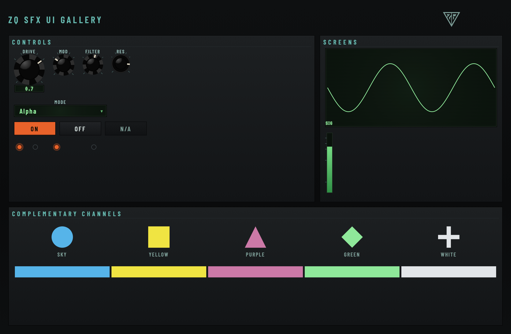

# zqsfx_ui

The shared ZQ SFX house UI: design tokens, a `LookAndFeel`, and a set of bound controls
(`Knob`, `Combo`, `LitToggle`, `TextToggle`, `Led`, `PhosphorScreen`, `PeakMeter`,
`LogoMark`) used by every ZQ SFX JUCE product so they read as one family - the same
dark chassis, type, readouts, control behaviour, and accessibility floor. It is a
design system, not a literal skin: decoration that makes a specific product what it is
(Broken's grime, screws, chipped knobs) stays with that product.



This module was lifted from Broken (`Project_TurboSynth`), the house's original design
baseline. `docs/ZQSFX_UI_STYLE_GUIDE.md` in the workspace this module was extracted
from is the spec of record for the values below.

## Consuming it (FetchContent)

Add JUCE first, then this module. It must come **after** JUCE is available, so its
CMakeLists can detect an existing `juce::juce_gui_basics` target and skip fetching its
own copy:

```cmake
include (FetchContent)

FetchContent_Declare (JUCE
    GIT_REPOSITORY https://github.com/juce-framework/JUCE.git
    GIT_TAG 8.0.6
    GIT_SHALLOW TRUE)
FetchContent_MakeAvailable (JUCE)

FetchContent_Declare (zqsfx_ui
    GIT_REPOSITORY https://github.com/themightyzq/zqsfx_ui.git
    GIT_TAG v0.7.1
    GIT_SHALLOW TRUE)
FetchContent_MakeAvailable (zqsfx_ui)

target_link_libraries (YourPlugin PRIVATE zqsfx::zqsfx_ui)
```

## Link target name

**`zqsfx::zqsfx_ui`** is the target name to depend on (an alias to `zqsfx::ui` also
exists and points at the identical library, but `zqsfx::zqsfx_ui` is the one to write
in new CMakeLists, since it is what `juce_add_module`'s `ALIAS_NAMESPACE zqsfx` always
produces for a module whose `ID` is `zqsfx_ui`). Linking it also pulls in the embedded
fonts and JUCE's recommended config/warning flags - no extra CMake steps.

## Usage example

```cpp
// PluginEditor.h
zqsfx::ui::LookAndFeel lookAndFeel;

// PluginEditor.cpp
MyEditor::MyEditor (MyProcessor& p) : AudioProcessorEditor (p)
{
    juce::LookAndFeel::setDefaultLookAndFeel (&lookAndFeel);

    // A rotary knob bound to an APVTS parameter, with a value readout.
    driveKnob = std::make_unique<zqsfx::ui::Knob> (
        p.apvts, "drive", "DRIVE", "Drive amount.", /*big*/ true);
    addAndMakeVisible (*driveKnob);

    // The company mark, wired as the About-box trigger.
    logo = std::make_unique<zqsfx::ui::LogoMark> ("My Product");
    logo->onClick = [this] { showAboutBox(); };
    addAndMakeVisible (*logo);

    setSize (900, 600);
}

MyEditor::~MyEditor()
{
    juce::LookAndFeel::setDefaultLookAndFeel (nullptr);
}
```

## Knobs

**The house knobs ship with the module and load by default.** They are three CC0 (public domain)
filmstrips from the [KnobGallery](https://www.g200kg.com/en/webknobman/gallery.php), 128 frames
each, chosen by dial size:

| Dial | Strip | Look | Gallery entry |
|---|---|---|---|
| 56 px and up | `strip_a` | silver cap in a black lobed skirt | #2638, SolurOathLabs |
| 42 px and up | `strip_b` | black, white pointer | #2410, dh96 |
| under 42 px | `strip_c` | brushed silver cap | #2075, C. Anders |

Full provenance, the unmodified `.knob` sources, and the exact render steps are in
`assets/knobs/` (`PROVENANCE.md`). Because they are CC0, there is nothing for a product to copy,
credit, or licence. They add about 2.6 MB to a binary.

A product with **its own knob art** replaces them. Broken does this: its Noisehead strips are
licensed for use inside plugin projects but may not be redistributed as a standalone resource,
so they stay in Broken's repository.

```cmake
zqsfx_ui_add_knob_strips (DIR assets/knobs TARGETS MyPlugin)   # after FetchContent_MakeAvailable (zqsfx_ui)
```

```cpp
#include "ZqsfxKnobStrips.h"
lookAndFeel.setKnobStripsFromMemory (ZqsfxKnobStrips::strip_a_png, ZqsfxKnobStrips::strip_a_pngSize,
                                     ZqsfxKnobStrips::strip_b_png, ZqsfxKnobStrips::strip_b_pngSize,
                                     ZqsfxKnobStrips::strip_c_png, ZqsfxKnobStrips::strip_c_pngSize);
// per-slider override, if a knob needs a specific strip regardless of its size:
knob.slider.getProperties().set ("zqsfxStrip", "xl"); // "xl" / "m" / "s"
```

If a strip image ever fails to load, the LookAndFeel draws a plain vector knob instead, so a
control is never invisible.

Section titles on `Panel` are drawn in the platform bold face, wide-tracked (the house
decision, and how Broken has always looked); labels and buttons use Barlow Condensed.

## Dial and double-click default

`Knob` bundles a title label, the silkscreen tick ring and a `Dial`. A product whose editor
is already laid out around plain `juce::Slider` members can get the same behaviour without
re-laying it out: change the member type to `zqsfx::ui::Dial` (it derives from
`juce::Slider`) and call `setDoubleClickDefault` after the attachment exists.

```cpp
zqsfx::ui::Dial gainSlider;                       // was: juce::Slider gainSlider;
gainAttachment = std::make_unique<APVTS::SliderAttachment> (apvts, "gain", gainSlider);
zqsfx::ui::setDoubleClickDefault (gainSlider, apvts, "gain");
```

A `Dial` takes keyboard focus and shows the focus ring; arrow keys step by the parameter
interval (or 1 % of the range) and Shift+arrow steps by a tenth of that.

**Typing a value.** Right-click a `Dial` for "Type a value…" and "Reset to default"; Return on
a focused one opens the same text box. Nothing to wire: `setDoubleClickDefault (slider, apvts,
id)` also tells the `Dial` which parameter to send the change to, so the host records it. For a
plain `juce::Slider`, keep a `zqsfx::ui::ValueEntry` member constructed on it (after the slider).
A subclass that already has its own right-click menu keeps it and adds the House items:

```cpp
zqsfx::ui::addValueEntryItems (menu, mySlider.valueEntry); // mySlider is a Dial subclass
```

**Typing needs keyboard focus.** Set `EDITOR_WANTS_KEYBOARD_FOCUS TRUE` in the product's
`juce_add_plugin`. With FALSE the VST3 window ignores keys and the AU view refuses focus, so the
text box opens but cannot be typed into.

**Every custom readout needs a matching parser.** Typed text is read back through the slider's
text-to-value conversion, so a parameter or slider with a custom readout ("50 %", "10.3 kHz",
"Off") must also say how to read it, or the typed readout sets the wrong value. Use `Knob`'s
`parse` argument (after `fmt`), `withValueFromStringFunction` on the parameter, or
`slider.valueFromTextFunction`. `Knob` with a `fmt` and no `parse` installs a default reader,
`zqsfx::ui::parseReadoutText`. It reads the first number in the text (skipping a label before it,
such as "Tonal 50"; keeping a sign before it, "- 5" included; reading "1,000" as a thousands
comma and "10,5" as a decimal comma), multiplies by 1000 for a `k` right
after the number ("10.3 kHz", "2k"), divides by 100 for `%` only when the range lies inside
-1..1, and reads "-inf" as the bottom of the range. Any other unit text is ignored. So a `fmt`
that changes units ("1.20 s" for a millisecond parameter), shows a side or sign as a word
("L 30 %"), shows `%` on a range wider than -1..1 ("150 %" on 0..2), or shows kHz for a
parameter already measured in kHz must pass its own `parse`. Words with no digits ("Off", "-inf") are
accepted when the slider shows the same word back for the value it read, alone or followed by a
unit ("-inf dB"). Opening the box and closing it without typing never moves the knob; anything
typed, even the same text, is applied.

## Resting displays

A display of live sound (meter, scope, spectrum, waveform) stops animating while it is hidden,
or after 2 seconds below -80 dBFS, and shows the dim mark instead:

```cpp
// processor: one flag, noted in processBlock (no allocation, no lock)
zqsfx::ui::ActivityFlag activity;            // processBlock: activity.noteBlock (buffer);

// display: owns a RestClock and starts or stops its own timer
zqsfx::ui::RestClock rest { *this, &processor.activity,
                            [this] (bool resting) { if (resting) stopTimer(); else startTimerHz (30); repaint(); } };
// paint: if (rest.isResting()) { zqsfx::ui::drawRestingMark (g, area); return; }
```

`ActivityFlag` lives in `zqsfx_ui/audio/ActivityFlag.h` and needs only `juce_audio_basics`, so a
processor header includes that file and never the GUI headers.

`PeakMeter` supports this directly: `meter.setResting (resting)` from the `RestClock` callback
draws an empty well (a meter is too thin for the mark). For ballistics call
`meter.setFallDbPerSecond (zqsfx::ui::PeakMeter::houseFallDbPerSecond)` (20 dB/s; the default 0
means no fall). `PeakMeter ("Input level.")` sets the tooltip and accessible title.

`PeakMeter::setFillColour (skin.noiseColour)` (a colour from the Product's Skin) gives a meter whose colour carries meaning a
solid fill instead of the gradient (the amber above -6 dB still draws); `std::nullopt` returns to
the gradient.

`RestClock` relabels the display's accessible description "No sound" while it rests on silence.
`rest.setDescriptionTarget (&other)` chooses a different component to carry that text (`nullptr`:
change nothing); switching the target while resting puts the old text back first.

`RestClock` checks four times a second, so a meter that reads a decaying level after waking can
miss a short hit. Read `ActivityFlag::takePeak()` instead: it returns the loudest peak since the
last call and clears it, so the hit shows its real peak. It consumes, so give it exactly one
reader (unlike `loudBlockCount`, which any number of displays can read). It also keeps the
loudest peak from the whole time the meter was hidden or resting, so call `takePeak()` once and
discard the result when the `RestClock` wakes the meter.

A Product's tests have no message loop, so they call `rest.poll()` themselves and fix the time
with `rest.setClockForTesting (...)` and `rest.setShowingForTesting (true)` (always available,
no `ZQSFX_UI_TESTING` needed).

A display of settings (an envelope or filter curve) passes `nullptr` for the flag: it rests only
while hidden, and keeps drawing its settings.

## About box

One About box for every Product, opened from the logo:

```cpp
logo.onClick = [this]
{
    zqsfx::ui::AboutInfo info;
    info.productName = "Worldizer";
    info.version = JucePlugin_VersionString;
    info.productId = "worldizer";                         // the Update notice panel; empty = none
    info.credits = { "Fonts: Barlow Condensed, IBM Plex Mono (SIL Open Font License)" };
    info.sourceUrl = "https://github.com/themightyzq/Worldizer";
    info.processor = &processor;                          // plugins: the delay row; apps: leave null
    zqsfx::ui::AboutBox::show (*this, info, &logo);
};
```

The box makes its own update panel from `productId`; the product's `UpdateNotice` stays on the
logo for the badge. It covers the window with a dimmed backdrop; Escape, Close or a click outside closes it. It uses
the module's look whatever the Product's own LookAndFeel is.

## Tokens

`zqsfx::ui::colour`, `zqsfx::ui::gradients`, and `zqsfx::ui::geom` (in
`zqsfx_ui/tokens/Tokens.h`) hold the base palette, gradients, and geometry constants.
Their values are byte-identical to Broken's `Theme.h` - this module never "improves" a
colour. See `docs/ZQSFX_UI_STYLE_GUIDE.md` sections 2 and 6 in the workspace this
module was extracted from for what each token means and where it is used.

## Complementary channels

`zqsfx::ui::comp` holds five colour-blind-safe channel colours (`sky`, `yellow`,
`purple`, `green`, `white`) for products that need to show several categories at once
(Unravel's tonal/transient/noise, LFlOw's lanes, SK4n's oscillators, and so on):

- **Five is the ceiling.** A sixth hue drops the worst-case separation below what is
  reliably distinguishable for colour-blind users; a product needing more than five
  categories encodes the rest by shape, pattern, or position instead.
- **Colour is never the only signal.** Pair every channel with a label, shape, or
  position too (see the demo gallery's "COMPLEMENTARY CHANNELS" panel: each swatch has
  a distinct marker shape as well as a colour).
- Assign channels in table order (`comp::all`, or `comp::channel(index)`), so a
  3-channel product uses `sky`, `yellow`, `purple`.
- No red channel (red means clip/error) and no orange channel (orange is `accent`,
  meaning active).

## Update notice

A product can tell its user that a newer version exists, without downloading anything. When the
editor opens, `UpdateNotice` checks a small JSON Version file at most once a day, in the
background (`https://themightyzq.github.io/audio-tools/versions.json`, or the address in the
`ZQSFX_UPDATE_URL` environment variable). If it names a newer version of your product, the
`LogoMark` shows a "!" badge and the About box can show the offer. Failure of any kind is silent.

```cpp
// in the editor, after the logo exists; the product id is the key in the Version file
logo = std::make_unique<zqsfx::ui::LogoMark> ("Worldizer");
updateNotice = std::make_unique<zqsfx::ui::UpdateNotice> (*logo, "worldizer", JucePlugin_VersionString);

```

The product's own `UpdateNotice` is only for the badge on its logo. The House About box (below)
carries its own update panel, made from `AboutInfo::productId`, so a product passes the id there
and does not build an `UpdateNoticePanel` itself.

The panel shows "<Name> <version> is available" with Get it, Later (24 hours) and Skip this
version, plus a "Check for updates" switch. The switch and the answers live in the folder
`ZQ SFX/Updates/` in the user's application-data folder (`~/Library/Application Support` on a
Mac) and are shared by every ZQ SFX product on the computer: turning the check off in one turns it
off in all. Declare the product's own version as a dotted number ("0.0.12").

### Keeping a Product's tests off the network

A Product's own tests are built without `ZQSFX_UI_TESTING`, so a headless editor test would
otherwise fetch the real file and write `last-check` into the real
`~/Library/Application Support/ZQ SFX/Updates` folder (which then skips the real check that day).
Set two environment variables before the editor is created (the check starts when it opens):

```cpp
setenv ("ZQSFX_UPDATE_URL", "off", 1);                        // "off", any case: no thread, no fetch, no write, no badge
setenv ("ZQSFX_UPDATE_SETTINGS_DIR", tempDir.getFullPathName().toRawUTF8(), 1); // absolute path only; else ignored
```

Any other value of `ZQSFX_UPDATE_URL` that is not an `https://` address is ignored.

What the check sends: it is an ordinary web request for that one file. GitHub, which hosts the
page, sees the computer's internet address and the host app's standard browser identification.
Nothing else is sent: no product list, no settings, no identifier.

Products build with `JUCE_USE_CURL=0`, so on Linux the check never succeeds (silently and
safely) and Linux users see no update notice.

## Accessibility floor

1. Every interactive control has an accessible title (`setTitle`), a tooltip, a
   description, and help text. `Knob`, `Combo`, `LitToggle`, and `TextToggle` all set
   these on their inner control automatically.
2. Keyboard focus is always visible: a 2 px `colour::accent` ring via
   `LookAndFeel::createFocusOutlineForComponent` (`geom::focusRingPx`). JUCE draws it only
   on components that opt in, and its own buttons, combo boxes and toggles never do, so
   call `zqsfx::ui::enableFocusRings (*this)` at the end of every editor constructor (and
   again after building controls at run time, or after a tab shows content that was not in
   the window before). A control that draws its own focus calls
   `zqsfx::ui::markOwnFocusRing` (Knob and LogoMark already do).
3. Text meets WCAG AA (4.5:1) at the size it is drawn - verified by `TokenTests`.
4. Hit targets are at least `geom::minHitTargetPx` (22 px).
5. Colour never carries meaning alone (see "Complementary channels" above).

## Building the gallery, running the snapshot tool and tests

```bash
cmake -S . -B build -DCMAKE_BUILD_TYPE=Release
cmake --build build -j 8

# interactive gallery app
open build/ZqsfxUiDemo_artefacts/ZQ\ SFX\ UI\ Gallery.app     # macOS; path varies per platform

# headless PNG renderer (writes snapshots/gallery.png and snapshots/gallery_disabled.png
# next to wherever you point it)
./build/ZqsfxUiSnapshot_artefacts/ZqsfxUiSnapshot snapshots/gallery.png

# console token tests
ctest --test-dir build --output-on-failure
```

`ZQSFX_UI_BUILD_DEMO` is `ON` when this repository is built directly (top-level) and
`OFF` when a product pulls it in via `FetchContent`, so a product's own build never
also compiles the gallery app, snapshot tool, or tests.

## Licence

GPL-3.0-or-later (see `LICENSE`), matching every ZQ SFX product that links JUCE's free
tier. The embedded fonts (Barlow Condensed, VT323, IBM Plex Mono) are licensed under
the SIL Open Font License; their licence texts ship alongside them in
`assets/fonts/OFL-*.txt`.

Built with JUCE. ZQ SFX, https://www.zq-sfx.com, connect@zq-sfx.com.

## Versioning

Semantic versioning. Token **values** only change in a major version - a product
pinning a tag can rely on `colour`/`comp`/`geom` never shifting under it within the
same major version. New tokens, new components, and behavioural additions are minor
versions; bug fixes are patch versions.
